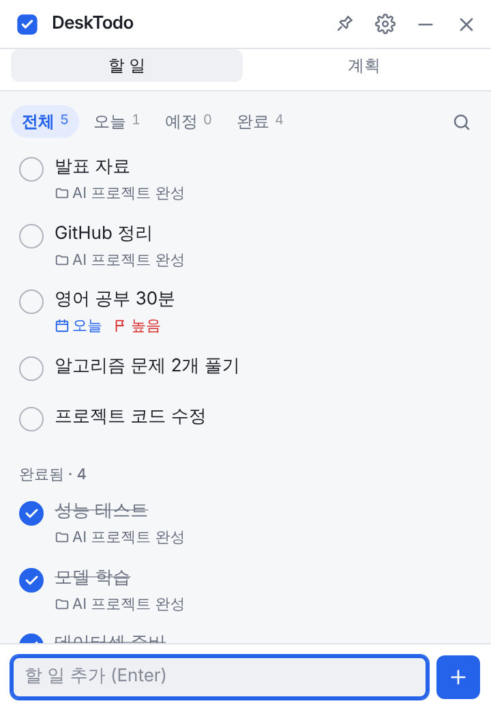
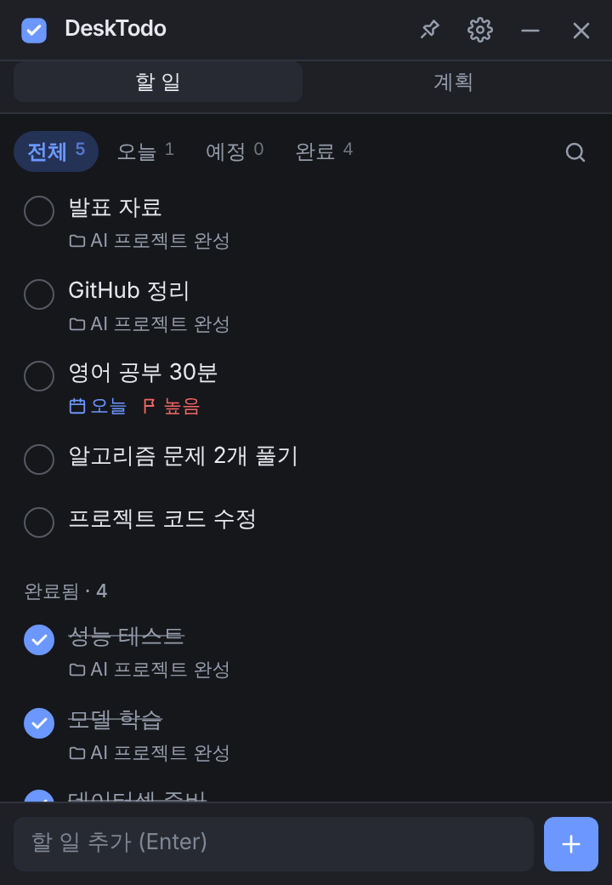
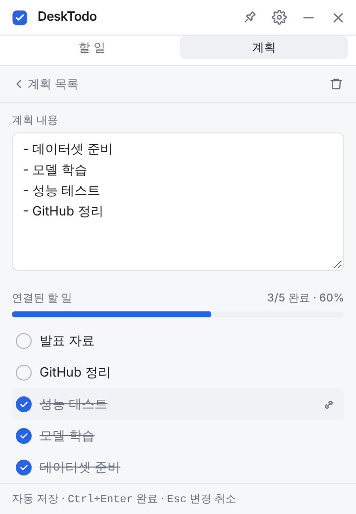

# DeskTodo

바탕화면 한쪽에 작게 띄워두고 쓰는 **가볍고 빠른 Windows용 To-Do & Planner** 데스크톱 앱입니다.
Tauri 2 + React + TypeScript + SQLite로 만들었고, 인터넷 연결·계정·외부 서버 없이 모든 데이터가 이 PC에만 저장됩니다.

<p>
  
  
  
</p>

## 주요 기능

**창 (Widget)**
- 기본 360×520px, 최소 300×380px, 자유롭게 크기 조절
- 자체 디자인 Title Bar: 빈 영역을 드래그하면 창 이동 (OS 네이티브 드래그, 이동 중 JS/React 동작 없음)
- 항상 위에 표시 토글(📌), 최소화, 닫기
- 창 위치·크기 저장 및 복원. 모니터 분리·해상도 변경으로 저장 위치가 화면 밖이면 화면 안으로 자동 복귀
- 중복 실행 방지: 두 번째 실행 시 기존 창을 앞으로 가져옴

**할 일**
- 입력 후 Enter로 즉시 추가 (빈 제목은 저장 불가), 실행 시 입력창 자동 포커스
- 체크박스로 완료/복원, 완료 항목은 취소선 + 흐리게 표시
- 클릭해서 편집: 제목, 메모(여러 줄), 마감일(오늘/내일/다음 주 빠른 선택), 우선순위, 계획 연결
- 삭제 후 5초간 **실행 취소** (토스트 버튼 또는 Ctrl+Z)
- 순서 변경: 드래그 앤 드롭 또는 Alt+↑/↓
- 필터: 전체 / 오늘(지난 마감 포함) / 예정 / 완료, 각 개수 표시
- 검색 (Ctrl+F), 정렬: 직접 정렬 / 마감일 / 우선순위

**계획 (Planner)**
- 제목, 여러 줄 계획 내용, 시작일·종료일
- 여러 할 일을 연결하고 완료율로 진행률 표시 (예: `3/5 완료 · 60%`)
- 계획 안에서 할 일 바로 추가, 기존 할 일 연결/해제
- 계획을 삭제해도 연결된 할 일은 삭제되지 않음 (연결만 해제)

**기타**
- 라이트 / 다크 / 시스템 테마, 마지막 화면·필터·정렬·테마 복원
- 자동 저장: 생성·완료·삭제는 즉시, 텍스트 입력은 500ms debounce, 창을 닫기 전 대기 중인 변경사항 저장
- 저장 실패 시 상단 경고 + "다시 시도", 작성 내용은 메모리에 보존되며 실패한 쓰기는 버려지지 않음.
  닫을 때 저장에 실패하면 종료를 멈추고 "다시 시도 / 버리고 종료"를 묻습니다.

### 단축키

| 키 | 동작 |
| --- | --- |
| Ctrl + N | 새 할 일 입력 (계획 화면에서는 새 계획) |
| Ctrl + F | 할 일 검색 |
| Ctrl + 1 / 2 | 할 일 / 계획 화면 |
| Ctrl + Enter | 편집 완료 (저장 후 닫기) |
| Esc | 편집 취소 (열었을 때 값으로 되돌림) · 검색/설정 닫기 |
| ↑ / ↓ | 목록에서 항목 이동 |
| Alt + ↑ / ↓ | 할 일 순서 변경 |
| Delete | 선택한 할 일 삭제 |
| Ctrl + Z | 방금 삭제한 할 일 복원 (텍스트 입력 중에는 일반 실행 취소로 동작) |

## 설치 및 실행 (Windows 10/11)

### 설치 파일로 설치 (개발 환경 불필요)
1. GitHub 저장소의 **Actions → CI & Windows build** 에서 최신 실행을 열고 `DeskTodo-windows-x64` Artifact를 내려받습니다.
2. 압축을 풀고 다음 중 하나를 실행합니다.
   - `bundle/nsis/DeskTodo_0.1.0_x64-setup.exe` — 현재 사용자용 설치 (관리자 권한 불필요, 권장)
   - `bundle/msi/DeskTodo_0.1.0_x64_en-US.msi` — MSI 설치
   - `desktodo.exe` — 설치 없이 바로 실행 (WebView2 런타임 필요)
3. **코드 서명이 되어 있지 않으므로** 처음 실행 시 SmartScreen 경고가 나올 수 있습니다. "추가 정보 → 실행"을 선택하세요.

**런타임 의존성**: Microsoft Edge **WebView2 Runtime** 하나뿐입니다. Windows 11과 최신 Windows 10에는 기본 설치되어 있으며,
없으면 설치 프로그램에 포함된 부트스트래퍼가 설치합니다(이 경우에만 인터넷 필요).

### 데이터 위치
- 데이터베이스: `%APPDATA%\com.desktodo.app\desktodo.db` (SQLite, WAL 모드)
- 창 위치/크기: `%APPDATA%\com.desktodo.app\window-state.json`

백업하려면 앱을 종료한 뒤 위 폴더를 복사하면 됩니다. (`desktodo.db-wal` 파일이 있다면 함께 복사)

## 개발

### 준비물
- Node.js 20+ (22 권장), Rust stable (1.77.2+)
- Windows: [Tauri 사전 요구사항](https://v2.tauri.app/start/prerequisites/) — Microsoft C++ Build Tools, WebView2
- Linux(개발/테스트용): `libwebkit2gtk-4.1-dev libayatana-appindicator3-dev librsvg2-dev libxdo-dev`

### 명령어
```bash
npm install
```
```bash
npm run tauri dev      # 개발 모드 실행 (Vite HMR)
```
```bash
npm run tauri build    # 프로덕션 빌드 → src-tauri/target/release/bundle/{nsis,msi}
```
```bash
npm run check          # 타입 체크 + ESLint + 단위/통합 테스트
```
```bash
npm run build && npm run e2e   # E2E (Playwright 필요: npm i --no-save playwright && npx playwright install chromium)
```
```bash
cd src-tauri && cargo test     # 창 위치 복원 로직 테스트
```

### 프로젝트 구조
```
src/
  main.tsx              부트스트랩 (테마 선적용, 닫기 가드, DB 로드)
  App.tsx               레이아웃, 화면 전환, 전역 단축키, 테마/항상 위 적용
  components/           TitleBar, TaskView/TaskItem/TaskEditor, PlanView/PlanEditor,
                        SettingsPanel, Notices(토스트·저장 오류·닫기 확인), ui, Icons
  db/                   SQLite 접근 (UI와 분리, 파라미터 바인딩만 사용)
    connection.ts       DB 열기 + WAL
    tasks.ts plans.ts settings.ts   리포지토리
  state/
    store.ts            최소한의 구독형 스토어 (useSyncExternalStore)
    saver.ts            Write-behind 저장 (debounce, 순서 보장, 실패 재시도)
    actions.ts          모든 상태 변경 + 검증
  lib/
    taskLogic.ts        필터/정렬/진행률/순서 계산 (순수 함수)
    dates.ts window.ts theme.ts shortcuts.ts useToday.ts
src-tauri/
  src/lib.rs            플러그인(sql, single-instance), 마이그레이션 등록
  src/geometry.rs       창 위치/크기 저장·복원·화면 밖 보정 (+ 단위 테스트)
  migrations/001_init.sql   스키마 v1 (tasks, plans, settings, 인덱스, 계획 삭제 트리거)
  capabilities/default.json 최소 권한
e2e/e2e.mjs             빌드 결과물 E2E + 성능 측정
```

## 설계 메모

- **권한 최소화**: `core:default` + 창 드래그/최소화/닫기/표시/포커스/항상 위 + `sql:default`, `sql:allow-execute` 만 허용. CSP 적용, 외부 네트워크 요청 없음.
- **창 위치 저장은 Rust에서 처리**: 창을 숨긴 채 생성 → 저장된 위치를 모니터 작업 영역 기준으로 검증·보정 → 첫 렌더 후 표시. 이동/리사이즈 중에는 네이티브 이벤트로 값만 기록하고 닫을 때 한 번 파일에 씁니다(원자적 쓰기).
- **저장 모델**: UI 상태를 먼저 바꾸고(즉각 반응) 변경된 항목만 "dirty"로 표시. flush 시 각 항목의 *최신 스냅샷*을 upsert/delete 하므로 연속 입력은 한 번의 쓰기로 합쳐지고 쓰기 순서가 꼬이지 않습니다. SQL 플러그인은 커넥션 풀을 쓰므로 여러 호출에 걸친 BEGIN/COMMIT은 사용하지 않고, 각 쓰기를 단일 원자적 문장으로 구성했습니다 (계획 삭제 시 할 일 연결 해제는 트리거로 같은 문장 안에서 처리).
- **렌더링**: 행 컴포넌트는 `memo` + 이벤트 위임으로 한 항목 변경 시 해당 행만 다시 렌더링. 긴 목록은 CSS `content-visibility: auto`로 화면 밖 행의 레이아웃/페인트를 생략 (별도 가상화 라이브러리 없음).
- **Idle 0%**: 폴링·인터벌·애니메이션 루프 없음. "오늘" 날짜는 타이머 대신 창 포커스/표시 이벤트 때 갱신.

## 라이선스

개인용 프로젝트입니다.
